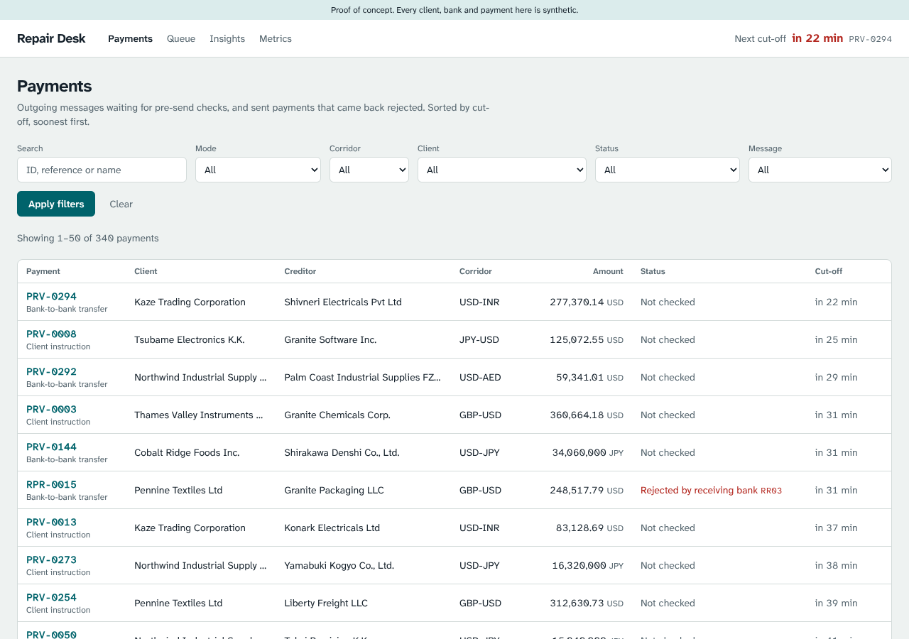

# TransactIQ: ISO 20022 payment repair POC

TransactIQ catches cross-border payment errors before a payment leaves the bank, explains
each one in plain words, suggests a fix, and sends every change through maker-checker
approval. It is a proof of concept built on free tiers (Next.js on Vercel, Neon Postgres).

> **Synthetic data only.** Every client, bank, account and payment is invented. Not for
> production use. Hosted on Vercel's Hobby plan, which is for personal, non-commercial use.



## Why now

From 14 November 2026, Swift CBPR+ rejects payments whose postal addresses are fully
unstructured. Town and country must sit in their own fields. Industry studies put
first-attempt failure at roughly 1 in 10 cross-border payments, mostly from bad data
rather than bad systems. TransactIQ targets the exceptions that remain after ISO 20022
migration.

## What's built (Sprints 1 to 3 of 4)

- **340 synthetic messages**: 300 outgoing (pain.001 client instructions and pacs.008
  bank transfers) to check before sending, and 40 sent payments rejected with a pacs.002.
- **Seeded errors with an answer key**: 133 known errors across nine failure buckets
  (addresses, party data, accounts, BICs, purpose codes, format, duplicates,
  amount/currency, screening look-alikes), each with its correct fix.
- **Payments list**: filter by mode, corridor, client, status and message type; open any
  payment to read its XML and, for rejects, the pacs.002 and reason code.
- **One-command reset**: `npm run seed` or `POST /api/reset` restores the exact demo state.

- **22 pre-send rules** across the nine buckets, each citing its CBPR+ or ISO source
  ([rule catalogue](docs/rule-catalogue.md)). On the seeded data they catch 93 of 93
  errors with no false positives, hold 5 duplicates and route 3 name matches to compliance.
- **Queue**: run the checks in one click, then work through what needs a person, soonest
  cut-off first, filtered by problem type. Each payment shows the problem in plain words
  with the faulty XML lines highlighted. Every pacs.002 reject gets its reason explained.
- **Metrics v1**: the checks scored against the answer key, by bucket and by rule.

- **Suggested fixes**: one per broken field, with confidence, source and a plain reason.
  Addresses are restructured from the free text (town, country, postcode in their own
  fields), confirmed against the bank's record and OpenStreetMap; Gemini is asked only
  when the rules are unsure. On the seeded data every shown suggestion is right (59/59
  addresses, 42/42 other fields). Accounts and amounts never get a suggested value: the
  tool drafts a message to the client instead.
- **Maker-checker repair**: sign in as a demo maker, accept or edit a fix, see the XML
  diff and a live re-check, submit; sign in as the checker and approve or send back.
  Enforced on the server, with every step in the payment's audit trail.

Coming next: insights on repeat errors, a drafted note to the client, and the demo
script (Sprint 4).

### Optional settings

| Variable | What it does |
| --- | --- |
| `GEMINI_API_KEY` | Free key from Google AI Studio. Turns on the Gemini fallback for addresses the rules can't read. Without it, those show options instead. |
| `SUGGESTION_MIN_CONFIDENCE` | Below this (default 0.7) the panel shows options or a blank field, never a guess. |
| `AUTH_SECRET` | Signs demo sessions; falls back to `RESET_SECRET`. |

## Run it locally

Requires Node 22 and a Postgres database (a free Neon project, or local Postgres).

```bash
npm install
cp .env.example .env.local      # then set DATABASE_URL and RESET_SECRET
npm run db:migrate              # create tables
npm run seed                    # load the synthetic dataset
npm run dev                     # http://localhost:3000
```

Other commands: `npm test`, `npm run lint`, `npm run typecheck`, `npm run synth`
(writes sample XML and the answer key to `data/synthetic/`), `npm run baseline:sheet`.

## Deploy (free, all in the browser)

No local Node install is needed.

1. In Vercel, choose **Add New > Project** and import this GitHub repo (Hobby plan).
   Leave build settings as detected.
2. In the Vercel project, open **Storage** and connect **Neon** from the Marketplace. This
   sets `DATABASE_URL` for Production and Preview.
3. Under **Settings > Environment Variables**, add `RESET_SECRET` (any long random string).
4. Redeploy (**Deployments > ... > Redeploy**) so the new variables take effect.
5. Open `https://<your-app>.vercel.app/setup`, enter the reset secret and click
   **Set up demo data**. This creates the tables and loads the synthetic dataset. Run it
   again any time to reset the demo.
6. Optional: add repository secrets `APP_URL` and `RESET_SECRET` to enable the nightly
   reset workflow.

## Project layout

| Path | What it holds |
| --- | --- |
| `lib/iso/` | Build and parse pacs.008, pain.001, pacs.002; CBPR+ character set |
| `lib/reference/` | Failure buckets, ISO code sets, corridors, synthetic banks and watchlist |
| `lib/synth/` | Deterministic generator: clients, suppliers, messages, seeded errors, answer key |
| `lib/db/`, `drizzle/` | Drizzle schema, client and SQL migrations |
| `lib/seed/` | Seed and reset |
| `app/`, `components/` | Pages and UI |
| `scripts/` | Seed, sample export, baseline sheet, GLEIF and OFAC importers |
| `tests/` | vitest: ISO round-trips and dataset integrity |

## Data sources

All demo data is generated. Optional real reference data can be imported from free
sources: GLEIF's BIC-to-LEI file (`npm run import:gleif -- file.csv`) and the US Treasury
OFAC SDN list (`npm run import:sdn -- sdn.csv`). ISO 20022 schemas and code sets come
from iso20022.org. See `DECISIONS.md` for the reasoning behind each choice.
