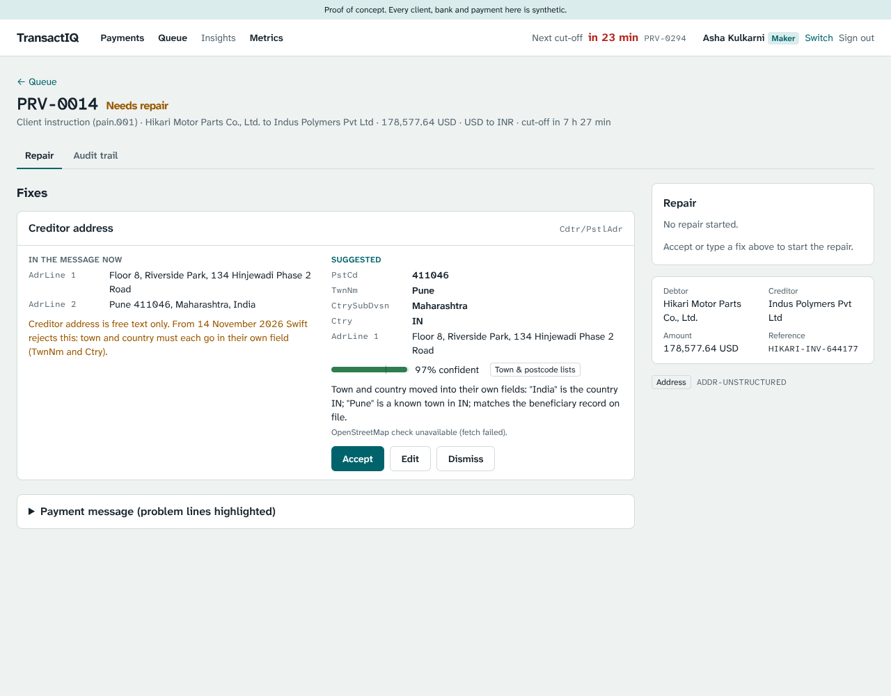
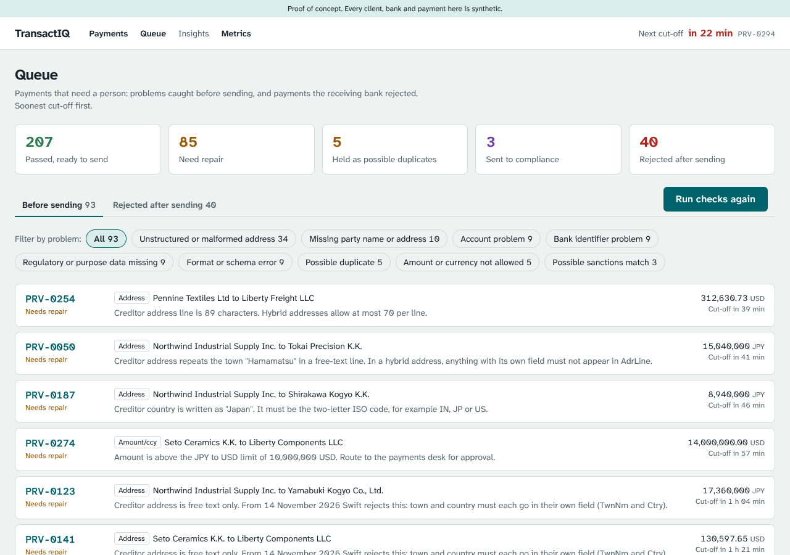
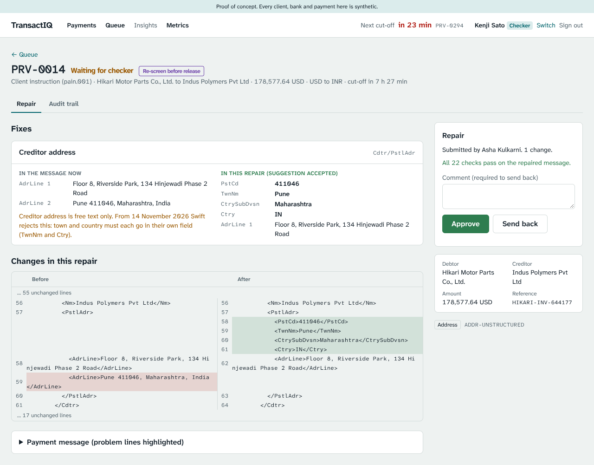
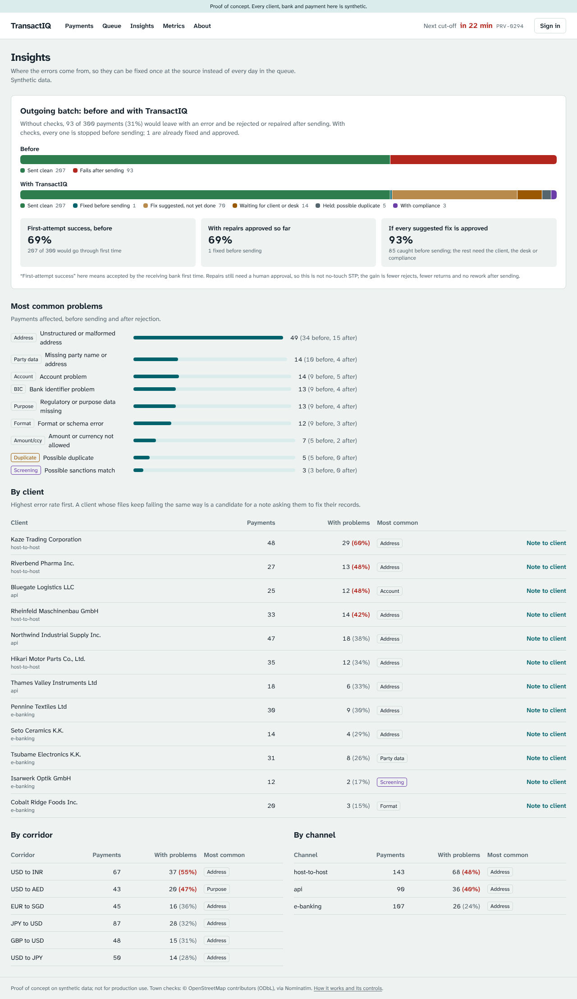
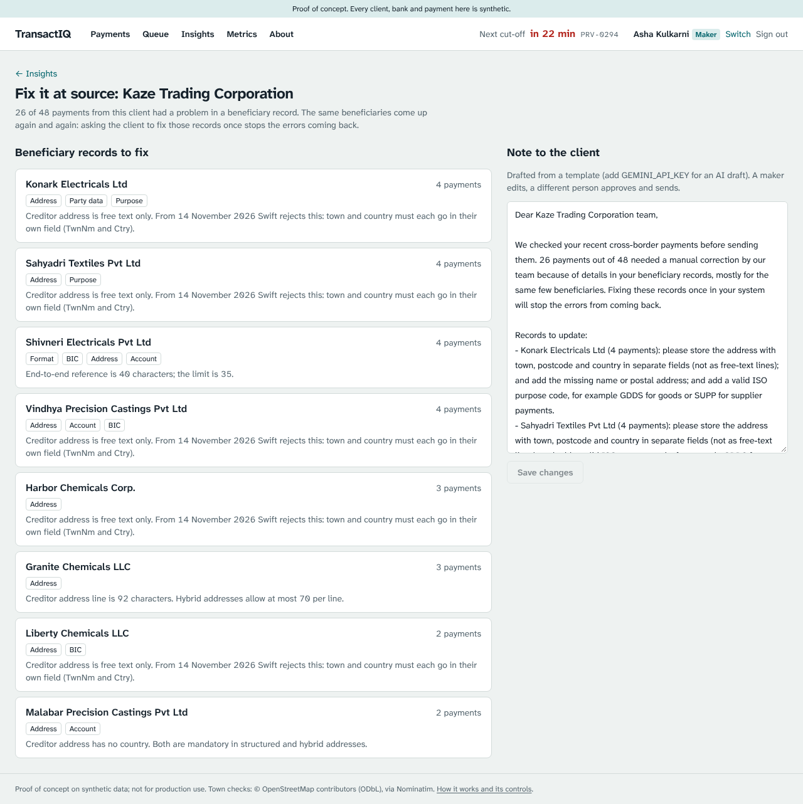

# TransactIQ: ISO 20022 payment repair POC

> **Not for production.** Synthetic data, demo sign-in, free tiers.

TransactIQ catches cross-border payment errors before a payment leaves the bank, explains
each one in plain words, suggests a fix, and sends every change through maker-checker
approval. It is a proof of concept built on free tiers (Next.js on Vercel, Neon Postgres).

> **Synthetic data only.** Every client, bank, account and payment is invented. Not for
> production use. Hosted on Vercel's Hobby plan, which is for personal, non-commercial use.



**Demo walkthrough:** [docs/demo-script.md](docs/demo-script.md)

## The problem

From 14 November 2026, Swift CBPR+ rejects payments whose postal addresses are fully
unstructured: town and country must sit in their own fields. Swift estimates about 65% of
messages still carry unstructured addresses. Industry-wide, about 1 in 10 cross-border
payments fails first time, at about $12.10 per failed or repaired payment (LexisNexis Risk
Solutions, Oct 2026). Banks that have migrated to ISO 20022 still have the exceptions: an
operations analyst reads XML, guesses the fix and resubmits. TransactIQ targets that work.

## What it does

1. **Check before sending.** 22 rules across nine failure types (addresses, party data,
   accounts, BICs, purpose codes, format, duplicates, amount/currency, sanctions look-alikes),
   each citing its CBPR+ or ISO source ([rule catalogue](docs/rule-catalogue.md)).
2. **Explain.** Each problem in plain words, with the faulty XML lines highlighted; every
   pacs.002 reject gets its reason code explained.
3. **Suggest a fix.** One per broken field, with confidence, source and reason. Addresses are
   restructured from the free text and confirmed against the bank's record and OpenStreetMap;
   Gemini is asked only when the rules are unsure. Below 70% confidence: options, not a guess.
4. **Repair with maker-checker.** Accept or edit, see the XML diff and a live re-check,
   submit; a different person approves. Enforced on the server, with a full audit trail.
5. **Fix it at source.** Insights by problem, client, corridor and channel, and a drafted
   note asking a client to fix the beneficiary records that keep failing.
6. **Measure honestly.** Every seeded error is in an answer key the rules never read; the
   Metrics page scores the tool against it and counts the guardrails (all must be zero).

| | |
| --- | --- |
|  |  |
|  |  |

## Results on the synthetic data

| Measure | Result |
| --- | --- |
| Seeded errors caught before sending | 93 of 93, no clean payment flagged |
| Rejects explained correctly | 40 of 40 |
| Address suggestions right, when shown | 58 of 58 (target 95%); the one hard case shows options instead |
| Other suggestions right (BIC, purpose, name, date, reference) | 42 of 42 |
| 150 messier test addresses, rules only | 126 shown, all right; 24 "not sure" |
| Guardrails (wrong repairs approved, self-approval, money-field edits, auto-release, unflagged party changes) | 0 |

The data is generated, and the errors were designed alongside the rules, so these numbers
show the tool behaves as designed. They are not a forecast for a bank's real payments; a
pilot on anonymised rejects is the way to measure that.

## The controls

1. Accounts, amounts and currencies are never suggested or edited.
2. Sanctions look-alikes go to compliance; nothing is suggested on them; any name or address
   change raises a re-screen flag.
3. Maker and checker must be different people, checked on the server.
4. All 22 rules re-run before submit and before approval; a repair that adds an error is blocked.
5. Confidence thresholds, sources on every suggestion, and an audit entry for every step.
   Gemini sees only address lines or anonymised facts.

## Architecture

Next.js 16 on Vercel (pages and server actions) · Neon Postgres via Drizzle · rules and
suggestion engines as pure TypeScript in `lib/` · optional Gemini Flash (AI SDK),
OpenStreetMap Nominatim and Resend. See the About page in the app for the diagram.

## Run it locally

Requires Node 22 and a Postgres database (a free Neon project, or local Postgres).

```bash
npm install
cp .env.example .env.local      # then set DATABASE_URL and RESET_SECRET
npm run db:migrate              # create tables
npm run seed                    # load the synthetic dataset
npm run dev                     # http://localhost:3000
```

Other commands: `npm test`, `npm run lint`, `npm run typecheck`, `npm run synth`
(writes sample XML and the answer key to `data/synthetic/`), `npm run baseline:sheet`,
`npm run rules:catalogue`, and `BASE_URL=... npm run e2e` (walks the demo path in a real
browser; needs `npm i -D playwright && npx playwright install chromium`).

## Deploy (free, all in the browser)

No local Node install is needed.

1. In Vercel, choose **Add New > Project** and import this GitHub repo (Hobby plan).
   Leave build settings as detected.
2. In the Vercel project, open **Storage** and connect **Neon** from the Marketplace. This
   sets `DATABASE_URL` for Production and Preview.
3. Under **Settings > Environment Variables**, add `RESET_SECRET` (any long random string).
4. Redeploy (**Deployments > ... > Redeploy**) so the new variables take effect.
5. Open `https://<your-app>.vercel.app/setup`, enter the reset secret and click
   **Set up demo data**. This creates the tables and loads the synthetic dataset. Run it
   again any time to reset the demo.
6. Optional: add repository secrets `APP_URL` and `RESET_SECRET` (GitHub > Settings >
   Secrets and variables > Actions) to enable the nightly reset workflow.
7. Optional: `GEMINI_API_KEY` for the AI fallback and AI-drafted client notes;
   `RESEND_API_KEY` and `NOTE_TO_EMAIL` (your own address) to email approved notes;
   enable Web Analytics in the Vercel project for page views.

### Optional settings

| Variable | What it does |
| --- | --- |
| `GEMINI_API_KEY` | Free key from Google AI Studio. Turns on the Gemini fallback for addresses the rules can't read and AI-drafted client notes. Without it, the rules and templates still work. |
| `RESEND_API_KEY`, `NOTE_TO_EMAIL` | Emails approved client notes to your own inbox. Without them, notes are approved and stored but not emailed. |
| `SUGGESTION_MIN_CONFIDENCE` | Below this (default 0.7) the panel shows options or a blank field, never a guess. |
| `AUTH_SECRET` | Signs demo sessions; falls back to `RESET_SECRET`. |

### Before a demo

Open `/api/health` a minute or two before you start: the free Neon database sleeps after
5 minutes idle and takes a few seconds to wake. It also shows whether Gemini and email are
configured. Reset the data from `/setup` if a previous demo changed it.

## Free-tier limits

| Service | Limit that matters here |
| --- | --- |
| Vercel Hobby | Personal, non-commercial use; function time limits |
| Neon free | 0.5 GB storage; sleeps after 5 minutes idle |
| Gemini free tier | Rate-limited; a 429 shows "suggestion unavailable" and the rules carry on |
| OpenStreetMap Nominatim | 1 request a second, identifying User-Agent, attribution; results cached |
| Resend free | Sends from onboarding@resend.dev to your own account address only |

## Project layout

| Path | What it holds |
| --- | --- |
| `lib/iso/` | Build and parse pacs.008, pain.001, pacs.002; CBPR+ character set |
| `lib/reference/` | Failure buckets, ISO code sets, corridors, synthetic banks and watchlist |
| `lib/synth/` | Deterministic generator: clients, suppliers, messages, seeded errors, answer key |
| `lib/db/`, `drizzle/` | Drizzle schema, client and SQL migrations |
| `lib/seed/` | Seed and reset |
| `app/`, `components/` | Pages and UI |
| `scripts/` | Seed, sample export, baseline sheet, GLEIF and OFAC importers |
| `lib/rules/` | 22 pre-send rules, the engine and the answer-key scorer |
| `lib/suggest/` | Suggestion engine, address engine, guardrails, Gemini and OpenStreetMap |
| `lib/repair/`, `lib/notes/` | Maker-checker workflows for repairs and client notes |
| `tests/` | vitest: rules against the answer key, suggestions, guardrails, workflow (local DB) |
| `e2e/` | Playwright walk through the demo path |

## Data sources

All demo data is generated. Optional real reference data can be imported from free
sources: GLEIF's BIC-to-LEI file (`npm run import:gleif -- file.csv`) and the US Treasury
OFAC SDN list (`npm run import:sdn -- sdn.csv`). ISO 20022 schemas and code sets come
from iso20022.org. See `DECISIONS.md` for the reasoning behind each choice.
